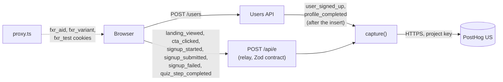

# Analytics plan

What we measure, how it is captured, and how the data stays trustworthy. This file holds the **single
definition of the primary metric**; every other document links here instead of restating it.

## Primary metric

**Signup conversion rate** = unique visitors (`distinct_id`) with at least one `user_signed_up` event ÷ unique
visitors with at least one `landing_viewed` event, over the same period, **excluding events with
`is_test = true`**.

- The numerator counts only accounts the server created: `user_signed_up` is captured in `POST /users` after
  the insert returns, never on a click and never on a failed or replayed request.
- Both events share the first-party visitor id (`fxr_aid`), so the ratio is per visitor, not per page view.
- Per variant, the same ratio is computed within each `variant` value (`control`, `quiz`).

## Architecture

- **Tooling:** PostHog (project "FXReplayChallenge", US region), reached only from the server. No PostHog
  script runs in the page: zero third-party JavaScript, nothing for ad blockers to drop, one place to enforce
  the contract (ADR-003).
- **Relay:** `POST /api/e` (`src/app/api/e/route.ts`) validates every browser event against
  `src/contracts/events.ts`, a closed set of names and enum properties. Anything else is a 400.
- **Server events:** `src/server/analytics.ts` sends `user_signed_up` and `profile_completed` from the
  Users API.
- **Identity and assignment:** `src/proxy.ts` sets HttpOnly first-party cookies: `fxr_aid` (random UUID visitor
  id), `fxr_variant` (experiment arm) and `fxr_test` (test traffic). No third-party cookies; no email, name or
  user id is ever the `distinct_id` (the user id is a property on server events).
- **Browser tracker:** `src/lib/track.ts`, a typed `fetch(..., { keepalive: true })` under 1 KB.

## Events

Properties added to **every** event by the server: `variant` (`control` or `quiz`, null if unassigned),
`is_test` (boolean), `source` (`relay` or `server`). Relay events also get `path` (same-origin path only),
`referrer_domain` (hostname only) and `utm_source`, `utm_medium`, `utm_campaign` (short tokens matching
`^[\w.\-+]+$`, at most 64 characters; anything else is dropped).

| Event | Trigger | Captured | Properties |
| --- | --- | --- | --- |
| `landing_viewed` | Landing renders (`PageView`) | Relay | common only |
| `cta_clicked` | A "Try FX Replay Free" link in the header or the final section | Relay | `cta_id`: `header` or `final` |
| `signup_started` | First focus on the email field (control) or first answer in the quiz (variant) | Relay | none |
| `signup_submitted` | A valid form is submitted (client validation passed) | Relay | none |
| `signup_failed` | The API answers with an error, or the request times out or fails | Relay | `error_code`: `VALIDATION_FAILED`, `EMAIL_TAKEN`, `IDEMPOTENCY_CONFLICT`, `INTERNAL`, `TIMEOUT`, `NETWORK` |
| `quiz_step_completed` | A quiz step is completed (variant only) | Relay | `step`: 1 or 2 |
| `user_signed_up` | `POST /users` created the account | Server | `user_id` (opaque UUID) |
| `profile_completed` | A self-service `PATCH /users/:id` succeeded | Server | `user_id`, `fields_count` |

## Funnel

1. `landing_viewed` (entry)
2. `signup_started`
3. `signup_submitted` (for the variant, `quiz_step_completed` steps 1 and 2 sit between 2 and 3)
4. **`user_signed_up` (conversion)**
5. `profile_completed` (activation guardrail, optional step)

In PostHog: an ordered funnel on those events, filtered to `is_test = false`, broken down by `variant`, with a
conversion window of 1 day.

## Data quality

- **One definition:** the primary metric is defined only here; EXPERIMENT and PERFORMANCE link to it.
- **Server-confirmed conversion:** the conversion can't fire on a click, a validation error, a 409, a 500, a
  timeout or an idempotent replay (unit tests in `tests/unit/users.test.ts`).
- **Closed contract:** event names and property values are enums validated on the server; a typo in code fails
  type checking, and a bad payload is a 400 that is visible in tests and logs, not a silent drop.
- **No PII:** no email, name or free text in any property, distinct id or URL. Referrers are reduced to a
  hostname and UTM values to short tokens, so a query string with an email can't leak (unit test). The user id
  is an opaque UUID.
- **Test traffic tagged, not dropped:** `is_test = true` when the request has `x-fxr-test: 1`, the `fxr_test`
  cookie (set from that header or `?fxr_test=1`), or an `@example.test` email. Playwright sends the header on
  every request, the smoke and API scripts send it too, and every scripted user uses `example.test`. The funnel
  filters `is_test = false`. The test users written to production are listed in `docs/ai-log.md`.
- **Failures are loud:** a PostHog error or a missing `POSTHOG_PROJECT_KEY` is logged as `analytics_failed`
  (event name and error class only) and never breaks the signup.
- **Known limits:** visitors who block cookies get no `fxr_aid` and their relay events are rejected (the
  conversion is still counted, with the user id as distinct id); clearing cookies starts a new visitor. Bots are
  not filtered beyond PostHog's defaults. A visitor who opens `/variants/quiz` directly is moved to the quiz arm
  (QA links); such links are not published.
