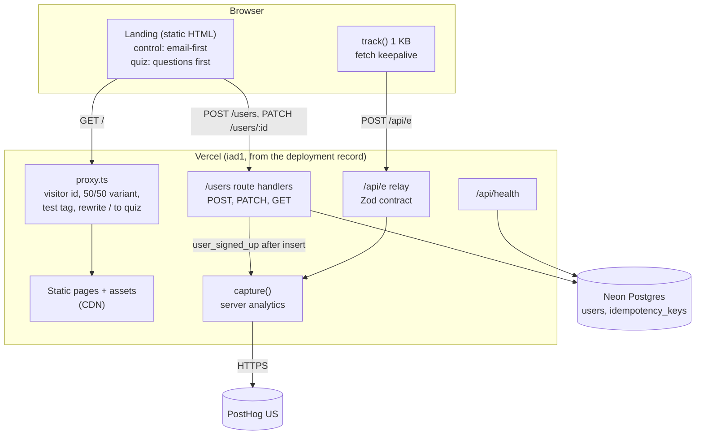

# Architecture

A "Try FX Replay Free" landing page with a signup flow, a Users API and server-side conversion tracking, in one
Next.js app on Vercel with Neon Postgres and PostHog. Decisions are in [DECISIONS.md](DECISIONS.md); this file
is the map.

## Overview

## Application structure

| Path | Responsibility |
| --- | --- |
| `src/app/page.tsx`, `src/app/variants/quiz/page.tsx` | The two experiment arms; both statically prerendered |
| `src/components/landing/` | Landing sections, page-view and CTA tracking |
| `src/components/SignupForm.tsx`, `QuizSignup.tsx`, `ProfileStep.tsx` | Signup states, quiz steps, optional profile |
| `src/contracts/` | Zod schemas shared by browser and server: users and analytics events |
| `src/app/users/`, `src/server/users.ts` | Users API and its persistence |
| `src/server/http.ts`, `auth.ts` | Uniform errors, logging, admin token, signed profile cookie |
| `src/server/analytics.ts`, `context.ts`, `src/app/api/e/` | Event capture, visitor context, the relay |
| `src/proxy.ts` | Visitor id, variant assignment and rewrite, test tagging |
| `src/db/` and `drizzle/` | Schema, driver selection (PGlite or Neon), migrations |
| `scripts/` | Brand token and asset generation, migrate-on-deploy, smoke and API checks, config validator |
| `.claude/`, `CLAUDE.md`, `.mcp.json` | The Claude Code system ([AI_WORKFLOW.md](AI_WORKFLOW.md)) |

## Major decisions and trade-offs

- **One Next.js app** for the landing, API and relay (ADR-001): one deploy and one contract, at the cost of
  coupling the marketing page and the API release cycles. For a team, the API would move to its own service.
- **Postgres everywhere** (PGlite in tests, Neon in production): tests exercise the real constraints (unique
  email, SQLSTATE 23505). Trade-off: Neon's HTTP driver has no interactive transactions, so idempotency uses two
  statements with documented gaps (ADR-004).
- **No password at signup** (owner decision 9): one field, minimum friction. Account access is out of scope; a
  signed 30-minute HttpOnly cookie lets the new user complete the optional profile.
- **Server-side conversion and a first-party relay** (ADR-003): zero third-party JavaScript and a conversion
  that can't be blocked or faked by the browser, at the cost of PostHog's autocapture and session replay.
- **Server-side experiment assignment with a rewrite** (ADR-011): no client flash and no layout shift; the
  pages stay static, but the proxy marks responses `private, no-store`, so `/` is not edge-cached per visitor.
- **Generated brand tokens and copied assets** (ADR-005, ADR-012): nothing transcribed by hand; contrast
  failures in the kit are replaced with existing primitives.

## API and integration approach

- REST on Route Handlers: `POST /users`, `PATCH /users/:id`, `GET /users` (README table, ADR-004).
- One Zod contract per boundary, shared by the form and the handler; strict objects reject unknown fields.
- Uniform error shape `{ error: { code, message, requestId, fields? } }`, statuses 400, 401, 403, 404, 409, 500.
- Idempotency-Key on signup, reused by the client across retries, replayed for 30 minutes.
- The browser never holds a secret: the admin token is server-only; the profile cookie is HttpOnly.
- Client timeout (10 s) in `src/lib/api.ts`; user-triggered retries in `SignupForm.tsx` reuse the
  Idempotency-Key (a new key after `IDEMPOTENCY_CONFLICT`); double submits are blocked.

## Deployment architecture

- **GitHub to Vercel:** every PR gets a preview (except `dependabot/**` branches); `main` deploys to production
  at <https://fx-replay-challenge.vercel.app>. Build command `pnpm run vercel-build`.
- **Migrate-on-deploy:** `scripts/vercel-build.mjs` runs migrations only when `VERCEL_ENV=production`; previews
  never migrate, and `migrate.mjs` refuses Neon anywhere else (ADR-009).
- **Configuration:** `DATABASE_URL` from the Neon integration; `ADMIN_TOKEN`, `SESSION_SECRET` and
  `POSTHOG_PROJECT_KEY` set in Vercel by the owner. Missing settings fail loudly.
- **CI (GitHub Actions, required on `main`):** lint (ESLint, Prettier, markdownlint), typecheck, unit tests,
  config and brand checks, build, E2E with axe on desktop and 360 px, Lighthouse CI gates, CodeQL, gitleaks on the
  full history, `pnpm audit --prod`. Actions are pinned to commit SHAs; Dependabot with a 7-day cooldown.

## Infrastructure considerations

| Area | Today | Notes |
| --- | --- | --- |
| Hosting | Vercel Hobby, functions in `iad1` (Vercel API deployment record); Neon Free, region chosen at setup (Washington, D.C.; not verified inside Neon) | Free tiers ($0) |
| DNS | `*.vercel.app` | A custom domain would add `__Host-` cookie benefits and HSTS preload on the apex |
| CDN and edge | Vercel CDN for static assets; pages prerendered | `/` passes through `proxy.ts` and is `private, no-store` |
| Caching | Static HTML and hashed assets; API responses `no-store` | Edge-cached variant pages per arm are a next step |
| Observability | Structured JSON logs (error class and SQLSTATE only, request ids), Vercel runtime logs and errors, PostHog events, `/api/health` | No alerting yet |
| Security | HSTS from Vercel, HttpOnly Secure cookies, admin token in constant time, CodeQL, gitleaks | See [SECURITY.md](SECURITY.md) for gaps |
| Reliability | Stateless functions, managed Postgres, idempotent signup, smoke script | Single region; no rate limiting yet |

## What would change for a production FX Replay system

- Create the account in FX Replay's real identity system (or hand off to its signup with the collected data)
  instead of a separate users table, with email verification and the app as the success destination.
- Rate limiting and bot protection on `/users` and `/api/e`, a strict CSP and security headers, signed visitor ids.
- Store analytics in FX Replay's existing PostHog project with a reverse proxy and server-side feature flags for
  experiments; replace the cookie flag with PostHog experiments once traffic justifies it.
- Alerting on signup error rates and health, Sentry for client errors, error budgets per endpoint.
- A custom domain, multi-region reads, preview databases migrated per branch.
- Localisation and consent management for the regions FX Replay serves (TODO(owner): which languages and regions).
